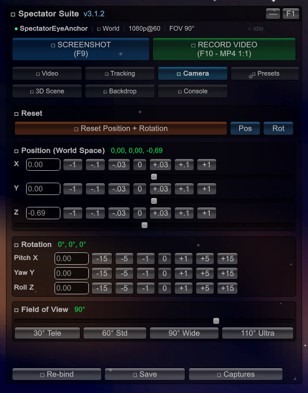

# 🎥 Unity Spectator Camera & 3D Virtual Studio Suite (v3.1.0)

[](https://github.com/ddavantaj/SpectatorInjectorKit/releases/tag/v3.1.0)
[]()
[]()

A high-performance, standalone Spectator Camera, 3D Virtual Studio Set, and Screen Capture Suite designed for Unity Mixed Reality (MR / VR / OpenXR) Windows builds.

Works as a **1-click standalone injector on any compiled Windows game build** (without needing Unity Editor or project rebuilding) or as a native Unity C# script component.

---

## 📸 Showcase & In-Game Previews

<p align="center">
  
  
</p>

---

## ⚡ Download & Quick Start

### 📦 1-Click Standalone Injector (No Unity Editor Required)
1. Download the latest pre-packaged release: **[SpectatorInjectorKit_v3.1.0.zip](https://github.com/ddavantaj/SpectatorInjectorKit/releases/download/v3.1.0/SpectatorInjectorKit_v3.1.0.zip)**.
2. Extract the ZIP archive anywhere on your PC.
3. Double-click **`Inject.bat`** (or `InjectSpectatorCamera.exe`).
4. Select your target game folder when prompted (the folder containing your game `.exe`).
5. Launch the game executable. The Spectator Camera and Control Panel will appear automatically on your screen!

### 🛠️ Unity Project Integration
* Include `SpectatorCameraController.cs` in your `Assets/Scripts/` folder.
* It auto-initializes upon scene load via `[RuntimeInitializeOnLoadMethod]`.

---

## ⌨️ Hotkeys & Control Reference

| Key / Shortcut | Action | Description |
| :--- | :--- | :--- |
| **`F1`** | **Toggle UI** | Show / Hide the Spectator Suite on-screen Control Panel. |
| **`F9`** | **Take Screenshot** | Capture ultra-crisp PNG screenshot (8x MSAA & Alpha transparency support). |
| **`F10`** | **Toggle Recording** | Start / Stop 60 FPS MP4 video recording with **synchronized in-game audio** & **1:1 Real-Time Speed Sync**. |
| **`W / A / S / D`** | **Move Camera** | Fly Forward, Left, Backward, Right in 3D World Space. *(Auto-locks world position)* |
| **`E / Space`** | **Fly Up** | Elevate camera upwards in World Space. |
| **`Q / Left Ctrl`** | **Fly Down** | Lower camera downwards in World Space. |
| **`Left Shift`** | **Speed Boost** | Hold to move faster (Turbo speed). |
| **`Right-Click Drag`** | **Mouse Look** | Orbit, pitch, and yaw camera view. |

---

## 🌟 Key Features & Capabilities (v3.1.0)

### 1. 🗂️ Categorized Accordion Control Panel
* Clean, categorized layout with 7 collapsible foldout boxes (`[ ▲ Hide / ▼ Open ]`) and live status badges:
  1. **🎥 1. Video Setup & Stabilization** `[ 1080p @ 60 FPS | 🎬 Steadicam ON | 🔊 Audio ON ]`
  2. **👤 2. VR Tracking & Free-Flight** `[ Following VR / Locked ]`
  3. **🎥 3. Camera Position, Rotation & FOV** `[ FOV: 60° ]`
  4. **💾 4. Camera Presets** `[ 4 Slots Saved/Empty ]`
  5. **🧱 5. 3D Scene Objects & Cyclorama** `[ Active / None ]`
  6. **🎨 6. Skybox & Background Fill** `[ Solid Fill / Transparent ]`
  7. **💻 7. Proxima In-Game Inspector & Cheats** `[ Terminal & Quick Cheats ]`

---

### 2. 🎬 High-Performance Zero-Lag 60 FPS Video & Audio Recording Suite
* **🔊 In-Game Master Audio Recording**:
  * Native DSP capture directly from Unity's master `AudioListener` (`OnAudioFilterRead`).
  * Pure 16-bit stereo PCM capture with zero background noise and crystal-clear game sound.
  * Encoded via FFmpeg into high-fidelity AAC (192 kbps) without affecting video latency.
* **Zero-GC Buffer Recycling Engine**: Pre-allocated frame buffer pool recycling memory with **0 MB/s GC allocation**, eliminating recording micro-stutters.
* **Cinematic Video Stabilization (Steadicam / Gimbal Damping)**:
  * Dynamic real-time spherical interpolation (`Vector3.Lerp` / `Quaternion.Slerp`).
  * Presets: `Subtle (12.0)`, `Cinematic (6.0)`, `Heavy/Drone (2.5)` + interactive damping slider.
* **Multi-Resolution & Hardware Encoding**:
  * Resolutions: `1080p (Full HD)`, `720p (Ultra Fast)`, `Native Screen`.
  * Frame rates: `60 FPS (Silky Smooth)` and `30 FPS (Low CPU Load)`.
  * Encoders: `⚡ Zero-Lag (NVENC Ultra-Low Latency p1)`, `⚖️ Balanced`, `💎 High Quality`.
* **1:1 Real-Time Sync**: Exact elapsed time synchronization guarantees 1s in game = 1s in MP4 video.

---

### 3. 👤 Real-Time VR Headset Tracking & Free-Fly Mode
* **`Follow Main Camera (VR Headset / 1st Person)`**:
  * Seamlessly tracks the player's VR Headset (`CenterEyeAnchor` / `Camera.main`) 1:1 in real time for authentic first-person recording.
* **`Lock World Position (Static PC Camera)`**:
  * Unchecking the follow toggle locks the camera at fixed 3D coordinates in world space.
  * Pressing `WASD` or right-click dragging the mouse instantly engages world space flight without abrupt jumps.

---

### 4. 🧱 Physical 3D In-Game Shapes & Virtual Studio (True 3D Parallax)
The background is an **actual 3D physical object anchored in the game scene**, providing authentic 3D perspective and depth parallax when the spectator camera moves around the scene.

* **3D Virtual Studio Modes**:
  * 🖼️ **`Curved Studio Backdrop (Cyclorama)`**:
    * **`Bend Sides (Wrap X)`**: Real-time horizontal mesh curvature from `0°` (flat) to `110°` (studio cyc) to `240°` (full wrap-around).
    * **`Bend Top/Bottom (Wrap Y)`**: Real-time vertical mesh curvature from `0°` (flat) to `120°` (dome / bowl wrap).
  * 🌐 **`360° Sphere Dome`**: Inverted 360° sphere mesh for panoramic HDRI environments.
  * 🔲 **`Flat Wall`**: Classic flat 3D studio wall / backdrop poster.
* **Native Pure C# Radiance HDR (.hdr RGBE) Decoder**: Binary decoder with Reinhard tonemapping (no external libraries needed). Also supports standard PNG, JPG, and BMP formats.
* **Manual Numeric Scale Inputs**: Direct text boxes to type exact dimensions for `Width (Scale X)`, `Height (Scale Y)`, and `Depth / Radius (Scale Z)`.
* **`[ 🎯 Place Behind View ]`**: Instantly snaps the 3D shape in front of the current camera view and anchors it permanently in 3D world space.
* **Brightness / Exposure Slider**: Adjust ambient illumination from `0.05x` to `5.0x`.

---

### 5. 💾 Camera-Only Presets (P1 – P4)
* **`Save Cam P1 - P4` / `Load Cam P1 - P4`**:
  * Saves and restores **only the camera properties** (Position, Rotation, FOV, Speed, Lock).
  * 🔒 **Skybox & 3D Backdrop Preservation**: Switching camera presets will **never** alter, reset, or override your loaded 3D environment or cyclorama settings.

---

### 6. 🔁 Full Automatic Persistence (`SpectatorSettings.ini`)
* All settings automatically save every 5 seconds, upon closing the application (`OnApplicationQuit`), or by clicking `[ 💾 Save Now ]`.
* **When reopening the game, everything is automatically restored**:
  1. Exact Camera Position, Rotation, FOV, Speed, and Stabilization settings.
  2. Active 3D shape file path and loaded texture.
  3. 3D Shape World Position, Rotation, Scale X/Y/Z, and Curvature Angles.
  4. Shape Brightness and Solid Color / Transparency configurations.
  5. All 4 saved Camera Presets.
  6. Proxima Terminal input values.

---

### 7. 💻 Proxima Inspector & In-Game Cheats
* **Quick Action Cheats**:
  * `Set Level` / `Load Level` / `Load Menu`
  * `Set Coins (set_coins)`
  * `Set Lives (set_lives)`
  * `Set Stars (set_stars)`
  * `Win Level (win_level)` / `Lose Level (lose_level)`
  * `Recenter Area` / `Reset Tutorials` / `Clear Save`
* **Custom Command Console**: Execute any internal game or Proxima method dynamically via reflection directly from the in-game UI.

---

## 📁 File Structure & Storage

```text
Captures/
├── Screenshots/          # F9 PNG screenshots
├── Videos/               # F10 MP4 video recordings
├── CustomSkyboxes/       # User HDR/JPG/PNG background files
└── SpectatorSettings.ini # Persistent settings storage
```

---

## 📖 Multilingual Documentation

For instructions in Romanian and Russian, please see **[`README_INSTRUCTIONS.TXT`](./README_INSTRUCTIONS.TXT)**.

---

## 📄 License
This project is licensed under the MIT License.
