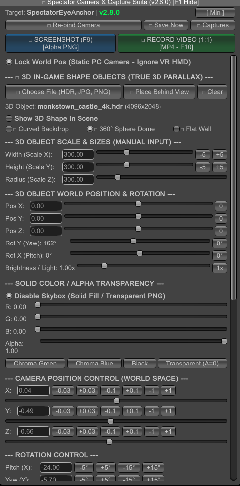

# 🌐 Universal Unity VR Spectator Camera & 3D Virtual Studio Suite (v1.0.0-Universal)

A standalone, universal Spectator Camera, 3D Virtual Studio Set, and Screen Capture Suite engineered to work with **ANY Unity VR / Mixed Reality game build** on Windows (OpenXR, Meta/Oculus XR SDK, SteamVR, XR Interaction Toolkit), even if the game **never had a spectator camera included in the original build**.

---

## 🌟 What Makes It Universal?

1. **⚡ Dynamic Spectator Camera Auto-Creation**:
   * If the target VR game build has no spectator camera, the injector automatically creates a dedicated desktop spectator camera at runtime (`stereoTargetEye = StereoTargetEyeMask.None`, `depth = 999`), rendering exclusively to the PC screen while keeping the VR headset view untouched.
2. **👤 Universal VR Headset Detection & 3 Camera Follow Modes**:
   * 🎯 **`1st Person (Headset 1:1)`**: Tracks the player's VR headset in real-time.
   * 🎥 **`3rd Person (Over-The-Shoulder / Drone Follow)`**: Smooth cinematic follow behind/above the player with adjustable distance and height.
   * 🛸 **`Free Flight (3D World Space)`**: Fly anywhere freely in the game world with `WASD` + `Right-Click Mouse Look`.
3. **🎬 Zero-Lag 60 FPS Video Recording (MP4)**:
   * Zero-GC buffer pool with 0 MB/s allocation and hardware NVENC Ultra-Low Latency encoding.
4. **🎥 Cinematic Steadicam Video Stabilization**:
   * Positional and spherical rotational damping (`Vector3.Lerp` / `Quaternion.Slerp`).
5. **🧱 Physical 3D In-Game Shapes & Virtual Studio (True 3D Parallax)**:
   * Curved Studio Backdrop (Cyclorama), 360° HDRI Environment Sphere, Flat Wall, Pure C# Radiance HDR loader.
6. **🎨 Skybox & Background Transparency**:
   * Solid color fills and transparent PNG cutouts (Alpha = 0) with 8x MSAA edge smoothing.
7. **💾 Full Automatic Persistence**:
   * Saves and restores all settings in `SpectatorSettings.ini`.

---

## 📸 Showcase & In-Game Previews

  
  

---

## ⚡ Download & Quick Start

### 📦 1-Click Universal Injector (No Unity Project Required)
1. Download **[UniversalSpectatorKit_v1.0.0.zip](https://github.com/ddavantaj/SpectatorInjectorKit/releases/download/v1.0.0-universal/UniversalSpectatorKit_v1.0.0.zip)**.
2. Extract the archive anywhere on your PC.
3. Run **`Inject.bat`** (or `InjectSpectatorCamera.exe`).
4. Drag and drop any Unity game build folder or `.exe` into the console, or pick it from the dialog.
5. Launch the game executable. The Universal Spectator Camera and Control Panel will appear on your desktop monitor!

### 🛠️ Unity Project Integration
* Drop `SpectatorCameraController.cs` into your project's `Assets/Scripts/` folder.
* It auto-initializes upon scene load via `[RuntimeInitializeOnLoadMethod]`.

---

## ⌨️ Hotkeys & Control Reference

| Key / Shortcut | Action | Description |
| :--- | :--- | :--- |
| **`F1`** | **Toggle UI** | Show / Hide the Spectator Suite on-screen Control Panel. |
| **`F9`** | **Take Screenshot** | Capture ultra-crisp PNG screenshot (8x MSAA & Alpha transparency support). |
| **`F10`** | **Toggle Recording** | Start / Stop 60 FPS MP4 video recording with **1:1 Real-Time Speed Sync**. |
| **`W / A / S / D`** | **Move Camera** | Fly Forward, Left, Backward, Right in 3D World Space. *(Auto-switches to Free Flight)* |
| **`E / Space`** | **Fly Up** | Elevate camera upwards in World Space. |
| **`Q / Left Ctrl`** | **Fly Down** | Lower camera downwards in World Space. |
| **`Left Shift`** | **Speed Boost** | Hold to move faster (Turbo speed). |
| **`Right-Click Drag`** | **Mouse Look** | Orbit, pitch, and yaw camera view. |

---

## 🗂️ Categorized Accordion Control Panel

1. **🎥 1. Video Setup & Stabilization** `[ 1080p @ 60 FPS | 🎬 Steadicam ON ]`
2. **👤 2. VR Tracking & Free-Flight** `[ 1st Person / 3rd Person / Free Flight ]`
3. **🎥 3. Camera Position, Rotation & FOV** `[ FOV: 60° ]`
4. **💾 4. Camera Presets** `[ 4 Slots Saved/Empty ]`
5. **🧱 5. 3D Scene Objects & Cyclorama** `[ Active / None ]`
6. **🎨 6. Skybox & Background Fill** `[ Solid Fill / Transparent ]`
7. **💻 7. Proxima In-Game Inspector & Cheats** `[ Terminal & Quick Actions ]`

---

## 📖 Multilingual Documentation

For instructions in Romanian and Russian, please see **[`README_INSTRUCTIONS.TXT`](./README_INSTRUCTIONS.TXT)**.

---

## 📄 License
This project is licensed under the MIT License.
